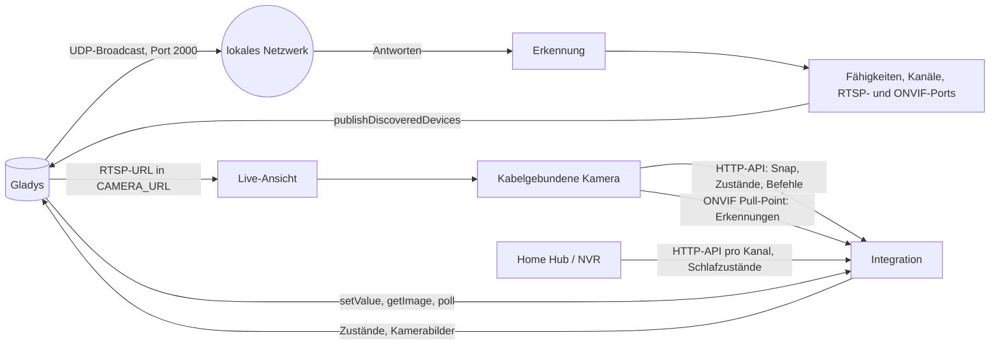
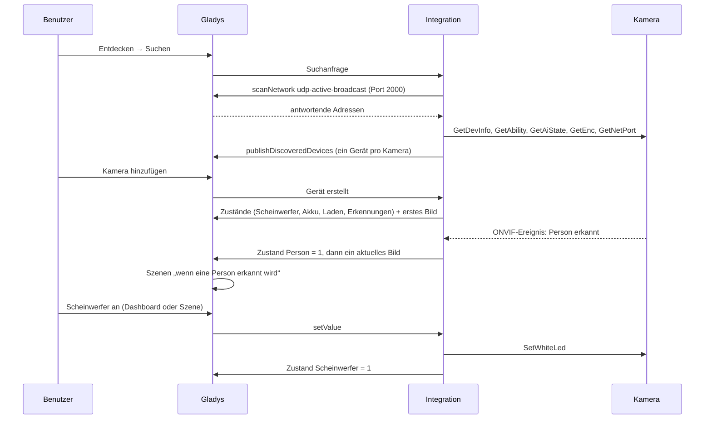
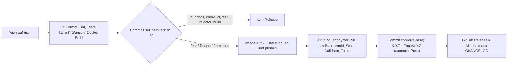

# Gladys Reolink

[English](README.md) · [Français](README.fr.md) · **Deutsch** · [Español](README.es.md)

[](LICENSE)
[](https://github.com/William-De71/gladys-reolink/releases)
[](https://github.com/William-De71/gladys-reolink/actions/workflows/release.yml)
[](https://gladysassistant.com)


Externe Integration für [Gladys Assistant](https://gladysassistant.com), die **Reolink**-Kameras, Video-Türklingeln,
Home Hubs und NVRs in Gladys bringt: Bilder auf dem Dashboard, Live-Video, sofortige Erkennung von Bewegung, Personen,
Fahrzeugen, Tieren und Klingeln als Szenen-Auslöser, Akkustand und Ladezustand sowie die Steuerung von Scheinwerfer,
Sirene, Infrarot-LEDs und motorisierten Köpfen (PTZ-Pfeile und gespeicherte Positionen). Aufgebaut auf
`@gladysassistant/integration-sdk` 0.15.

Alles bleibt **in Ihrem lokalen Netzwerk**: kein Reolink-Konto, keine Cloud.

Benutzerdokumentation: [English](docs/en.md) · [Français](docs/fr.md) · [Deutsch](docs/de.md) ·
[Español](docs/es.md).

> Community-Integration, weder mit Reolink verbunden noch von Reolink unterstützt.

## Inhalt

- [Funktionen](#funktionen)
- [Architektur](#architektur)
- [Geräte](#geräte)
- [Installation](#installation)
- [Konfiguration](#konfiguration)
- [Szenen](#szenen)
- [Sofortige Erkennungen über ONVIF](#sofortige-erkennungen-über-onvif)
- [Akkuschutz](#akkuschutz)
- [Transport](#transport)
- [Entwicklung](#entwicklung)
- [Release und Commit-Konvention](#release-und-commit-konvention)
- [Fehlerbehebung](#fehlerbehebung)
- [Designhinweise](#designhinweise)
- [Mitwirken](#mitwirken)
- [Lizenz](#lizenz)

## Funktionen

- **Ein Gerät pro Kamera**, ob direkt erreichbar oder an einem **Home Hub** oder einem **NVR**. Jede Kamera erhält
  die Funktionen, die sie tatsächlich hat: Die Integration fragt die Kamera (`GetAbility`, `GetAiState`), statt dem
  Modellnamen zu vertrauen.
- **Bild** auf dem Dashboard, regelmäßig und bei jeder Erkennung aktualisiert, und **Live-Video** über den
  rtsp-camera-Dienst von Gladys.
- **Erkennungen**: Bewegung, Person, Fahrzeug, Tier und Klingeln, von kabelgebundenen Kameras **sofort über ONVIF**
  gemeldet, bei den anderen regelmäßig abgefragt.
- **Aktoren**: Scheinwerfer, Sirene, Infrarot-LEDs, PTZ-Pfeile (begrenzte Schritte) und gespeicherte Positionen.
- **Akkumodelle**: Akkustand, Ladezustand und ein Schutz, der die Aufnahmen drosselt, bevor der Akku leer wird, und
  nie eine Kamera weckt, die ihr Hub als schlafend meldet.
- **Konfigurationsaktionen**: Verbindung testen (was jede Kamera kann, ONVIF, RTSP), PTZ-Positionen auflisten, alle
  Bilder aktualisieren.
- **Vier Sprachen** für den Konfigurationsbildschirm und die Ergebnisse der Aktionen: Englisch, Französisch, Deutsch,
  Spanisch.

Die Integration deklariert kein eigenes Dashboard-Widget: Die Kameras nutzen das Kamera-Widget von Gladys.

## Architektur




Vom Scan bis zur Erkennung:



## Geräte

| Reolink-Seite              | Gladys-Funktion (Kategorie / Typ)                    | Bei welchen Kameras                               |
| -------------------------- | ---------------------------------------------------- | ------------------------------------------------- |
| Schnappschuss (`cmd=Snap`) | `camera` / `image`, dazu die Live-Ansicht (RTSP)     | alle                                              |
| Bewegung                   | `motion-sensor` / `binary` „Motion“                  | alle                                              |
| KI-Erkennungen             | `motion-sensor` / `binary` „Person/Vehicle/Animal“   | Modelle mit KI-Erkennung                          |
| Klingeltaste               | `doorbell` / `ring`                                  | Video-Türklingeln                                 |
| Akku                       | `battery` / `integer` (%) und `battery` / `charging` | Akku- und Solarmodelle                            |
| Scheinwerfer               | `light` / `binary` (von der Kamera zurückgelesen)    | Modelle mit weißem Scheinwerfer                   |
| Sirene                     | `siren` / `binary`                                   | Modelle mit Alarmlautsprecher                     |
| Infrarot-LEDs              | `switch` / `binary` (von der Kamera zurückgelesen)   | die meisten Modelle                               |
| Schwenken / Neigen / Zoom  | `camera` / `move` (Pfeile, begrenzte Schritte)       | motorisierte Kameras (oder nur Zoomobjektiv)      |
| Gespeicherte Positionen    | `camera` / `preset` (Liste der Positionen)           | motorisierte Kameras mit gespeicherten Positionen |

Ein Gerät trägt in seinen Parametern alles, was nötig ist, um seine Kamera zu erreichen (Adresse, Port, Schema, Kanal,
Fähigkeiten, RTSP-URL, ONVIF-Port): Ein Poll, ein Befehl oder ein Bild braucht nie eine neue Suche. Seine externe ID
beruht auf der **UID** der Kamera, dann auf ihrer MAC-Adresse, dann auf ihrer IP-Adresse: Sie übersteht eine
Umbenennung und einen neuen DHCP-Lease.

## Installation

In Gladys (5.3.0 oder neuer): **Integrationen → Store → Reolink → Installieren**. Benutzername und Passwort der
Kameras eingeben, auf **Verbindung testen** klicken, dann **Entdecken → Suchen** und die Kameras hinzufügen. Siehe die
[Benutzerdokumentation](docs/de.md).

Aktivieren Sie auf den Kameras in der Reolink-App **HTTP** oder **HTTPS** (unverzichtbar), **RTSP** (Live-Video) und
**ONVIF** (sofortige Erkennungen): Einstellungen → Netzwerk → Erweitert → Servereinstellungen. Neuere Firmwares liefern
sie deaktiviert aus.

Docker-Image: `ghcr.io/william-de71/gladys-reolink`, Multi-Arch (amd64/arm64), ohne Root-Rechte, schreibgeschütztes
Dateisystem, OCI-Labels. Es enthält `ffmpeg`, das nur ein zu großes Schnappschussbild verkleinert.

## Konfiguration

| Schlüssel                        | Typ     | Standard | Rolle                                                                                 |
| -------------------------------- | ------- | -------- | ------------------------------------------------------------------------------------- |
| `username`                       | string  | `admin`  | das Konto, mit dem sich Gladys anmeldet, das der Reolink-App                          |
| `password`                       | secret  | —        | sein Passwort                                                                         |
| `stream_quality`                 | select  | `HD`     | HD (Hauptstream, bei Bedarf verkleinert) oder SD (Substream, schonender für den Akku) |
| `camera_addresses`               | string  | —        | Adressen, die die Suche nicht erreicht: `192.168.1.42, 192.168.1.43:8000`             |
| `camera_accounts`                | secret  | —        | Konten pro Kamera: `192.168.1.42\|gladys\|MeinPasswort`, durch Kommas getrennt        |
| `event_poll_interval`            | number  | 15       | Sekunden (5-300) zwischen zwei Abfragen der Kameras, die ihre Ereignisse nicht melden |
| `onvif_events`                   | boolean | an       | sofortige Erkennungen über ONVIF für direkt erreichbare kabelgebundene Kameras        |
| `capture_timeout`                | number  | 12       | Sekunden (5-60), die eine Kamera zum Antworten hat                                    |
| `image_refresh_interval`         | number  | 60       | Sekunden (15-3600) zwischen zwei Bildern einer Kamera mit Netzstrom                   |
| `battery_image_refresh_interval` | number  | 900      | Sekunden (60-86400) zwischen zwei Bildern einer Akkukamera                            |
| `battery_pause_refresh`          | number  | 60       | % unterhalb dessen die automatische Aktualisierung stoppt                             |
| `battery_stop_all`               | number  | 40       | % unterhalb dessen gar kein Bild mehr aufgenommen wird                                |
| `battery_resume`                 | number  | 80       | % ab dem eine pausierte Kamera fortfährt (mit Solar; am Ladegerät sofort)             |

## Szenen

Die Integration deklariert keine eigenen Szenen-Auslöser oder -Aktionen: Alles, was eine Kamera meldet, ist eine
**Gerätefunktion**, die der Szenen-Editor von Gladys bereits anbietet.

- **Auslöser**: „Wenn die Türklingel klingelt“ bei einer Türklingel; ein Bewegungsmelder namens „Person“, „Vehicle“
  oder „Animal“ geht auf 1 („wenn am Tor eine Person erkannt wird“); der Akku fällt unter einen Wert; eine
  Akkukamera beginnt oder beendet das Laden.
- **Aktionen**: Scheinwerfer, Sirene oder Infrarot-LEDs ein- oder ausschalten; eine motorisierte Kamera auf eine
  gespeicherte Position fahren (Preset) oder um einen Schritt bewegen (Move); das Bild der Kamera in einer Nachricht
  senden.

Beispiel: **Wenn** „Tor - Person“ erkannt wird, **dann** „Tor - Spotlight“ einschalten, das Bild von „Tor“ an die
Familie senden und den Scheinwerfer nach 3 Minuten ausschalten.

Eine Erkennung ist ein Impuls 1 → 0: Der Sensor geht auf 0 zurück, wenn die Kamera das Ende des Ereignisses meldet
(oder nach einer Sicherheitsfrist), sodass dieselbe Szene bei der nächsten Erkennung wieder auslöst.

## Sofortige Erkennungen über ONVIF


Die HTTP-API von Reolink beantwortet nur „gibt es gerade Bewegung“: Eine abgefragte Kamera hat also eine
Erkennungsverzögerung in Höhe des Abfrageintervalls, und ein kurzes Ereignis zwischen zwei Abfragen geht verloren.
Direkt erreichbare kabelgebundene Kameras werden daher über **ONVIF** abonniert (Pull-Point-Abonnement,
WS-UsernameToken-Digest): Die Kamera hält die Anfrage offen und antwortet, sobald eine Erkennung beginnt oder endet.

- Der ONVIF-Port kommt aus `GetNetPort`, das auch zeigt, wenn RTSP oder ONVIF deaktiviert ist — die Voreinstellung
  neuerer Firmwares.
- Der Digest wird mit der Uhr **der Kamera** gestempelt (über das nicht authentifizierte `GetSystemDateAndTime`
  gelesen), sodass eine Kamera mit abweichender Uhr nicht abgewiesen wird.
- Solange der Stream einer Kamera gesund ist, pausiert die Abfrage für sie; nach drei Fehlern fällt sie auf die
  Abfrage zurück und kehrt von selbst zu ONVIF zurück, sobald der Stream wieder läuft.
- Akkumodelle und Hub-/NVR-Kanäle bleiben bei der Abfrage: Erstere haben keinen ONVIF-Server, und die Ereignisse
  der Letzteren sagen nicht zuverlässig, von welcher Kamera sie kommen.

## Akkuschutz


Die Aufnahme ist es, die eine kabellose Kamera leert. Der Schutz weicht in zwei Stufen zurück, fährt erst deutlich
über der Pausenschwelle fort (kurze Zyklen nutzen den Akku ab), gibt eine Kamera am Ladegerät sofort frei und weckt nie
eine Kamera, die ihr Hub als schlafend meldet. Akkukameras haben außerdem ein eigenes Aktualisierungsintervall: Sie zu
schonen kostet die kabelgebundenen nichts. Akkustand und Ladezustand werden in jedem Fall weiter gelesen: Sie zeigen,
wann die Kamera wieder geladen ist.

## Transport

Nur `local`. Die Integration erreicht jede Kamera im lokalen Netzwerk über ihre dokumentierte HTTP-API, ONVIF und
RTSP; sie ruft nie einen Reolink-Server auf. Die Erkennung läuft über Gladys, das im Auftrag der Integration auf
UDP-Port 2000 sendet (ein Container empfängt nie einen Broadcast des lokalen Netzwerks). Kameras in einem anderen VLAN
können per Adresse eingetragen werden.

## Entwicklung

```bash
npm install
npm test               # Unit-Tests (node --test), ohne Netzwerk und ohne Kamera
npm run lint           # ESLint
npm run format:check   # Prettier, wie in der CI
npx github:GladysAssistant/integration-store . --skip-image-check   # Store-Prüfungen
docker build -t gladys-reolink:dev .
```

`ffmpeg` ist lokal optional: Es verkleinert nur ein zu großes Schnappschussbild. Ohne es greift die Integration auf
den Stream niedriger Auflösung der Kamera zurück. Aufbau des Codes: siehe [CLAUDE.md](CLAUDE.md).

- `test/structure.test.js` vergleicht die Geräte von vier Beispielkameras (kabelgebundene PTZ, Akku-Türklingel,
  Home-Hub-Kanal, einfache Kamera) sowie die Konfigurations- und Aktionsschlüssel mit
  `test/fixtures/discovery.baseline.json`, erzeugt aus Version 1.3.0: Eine externe ID, eine Kategorie, ein Typ oder
  eine Grenze ändert sich nie — sonst müssten die Benutzer ihre Kameras löschen und neu anlegen.
- `test/index.test.js` führt `index.js` gegen das Fake-Gladys des SDK aus (Geräteerstellung, Polls, Befehle).
- `test/i18n.test.js` prüft die vier Sprachen des Manifests, der Meldungen, der Dokumentation und der READMEs.
- `test/release.test.js` deckt das Release-Skript ab (Versionen, Changelog, Versionsanhebung).

Voraussetzungen: Gladys `>= 5.0.0` (die Funktion `battery` / `charging`; Katalog-Suchbegriffe und Länder von Gladys 5.3), Node.js `>= 22.20`.

## Release und Commit-Konvention

Releases sind automatisch. Jeder Push auf `main` startet den Release-Workflow:



- Commits und PR-Titel folgen [Conventional Commits](https://www.conventionalcommits.org/), auf Englisch und für den
  Benutzer geschrieben: Sie werden zu den Zeilen des Changelogs. `feat` → Minor, `fix` / `perf` → Patch, `!` oder
  `BREAKING CHANGE:` → Major.
- `CHANGELOG.md` wird beim Release erzeugt: nie von Hand bearbeiten.
- Das Image wird veröffentlicht und geprüft, **bevor** das Manifest auf `main` die neue Version ankündigt.
- Manueller Start (Actions → Release → Run workflow): `release-as` erzwingt eine Version, `dry-run` zeigt nur die
  Version und die Notizen.
- Ein geschützter `main`-Branch würde den Release-Commit ablehnen: GitHub Actions die Umgehung der Regel erlauben
  oder das Token einer GitHub App verwenden.

## Fehlerbehebung

| Symptom                                               | Wahrscheinliche Ursache                                                                      |
| ----------------------------------------------------- | -------------------------------------------------------------------------------------------- |
| Die Suche findet keine Kamera                         | Broadcast gefiltert oder anderes VLAN: Adresse unter „Kameraadressen“ eintragen              |
| „Verbindung abgelehnt“ beim Test                      | falsches Passwort oder ein Gastkonto, das die Kameraeinstellungen nicht lesen darf           |
| Das Live-Video startet nicht                          | RTSP ist auf der Kamera aus: in der Reolink-App aktivieren, dann erneut suchen               |
| Erkennungen kommen mehrere Sekunden zu spät           | die Kamera wird abgefragt: ONVIF aus, Akkumodell oder hinter einem Hub (siehe Test)          |
| Das Dashboard-Bild ist eingefroren                    | Akkukamera vom Schutz pausiert (Akkustand prüfen) oder sehr langes Intervall                 |
| Der Scheinwerfer schaltet sich von selbst aus         | der Beleuchtungsplan der Kamera; Gladys erweitert ihn nur, solange es ihn eingeschaltet hält |
| In Preset fehlt eine Position                         | Positionen werden bei der Suche gelesen: nach dem Speichern erneut suchen                    |
| Kein „Charging“ bei einer früher hinzugefügten Kamera | neue Funktion: Entdecken → Suchen, dann die Kamera **aktualisieren**                         |

Ausführliche Logs: die Umgebungsvariable `DEBUG=gladys-integration-sdk` am Container setzen.

## Designhinweise

**Alles wird in einem Stapel gelesen.** Die API arbeitet mit Stapeln, und ein Poll fragt Bewegung, KI-Zustand, Akku
und Türklingel in einem einzigen Hin und Zurück ab. Bei einem Akkumodell weckt jede Anfrage das Funkmodul: Getrennte
Abfragen würden je ein Aufwecken kosten.

**Eine Sitzung pro Kameraadresse, geteilt.** Eine Kamera akzeptiert nur eine Handvoll gleichzeitiger Sitzungen und
gibt sie nicht frei, wenn der Client verschwindet. Aufnahme, Aktoren und Poll teilen sich daher einen Client pro
Adresse. ONVIF trägt bei jeder Anfrage seinen eigenen Nachweis und belegt keine dieser Sitzungen.

**Eine Aufnahme pro Kamera zur gleichen Zeit.** Die Aktualisierungsschleife, der Poll von Gladys, eine Erkennung und
das Dashboard können dieselbe Kamera innerhalb einer Sekunde anfragen; sie teilen sich die laufende Aufnahme, statt die
Kamera mehrmals zu wecken.

**Nur Änderungen.** Erkennungen, Akku und Aktoren werden veröffentlicht, wenn sie sich ändern, nie bei jedem Poll
erneut: Gladys nimmt 300 Zustände pro Minute von einer Integration an, und ein unveränderter Wert würde nur den
Verlauf füllen. Wenn der Benutzer eine Kamera hinzufügt, wird alles einmal neu veröffentlicht, da Gladys die vor der
Existenz eines Geräts gesendeten Zustände verwirft.

**Die Fähigkeiten kommen von der Kamera, nie vom Modellnamen.** Zwei Kameras derselben Serie unterscheiden sich, und
`GetAbility` hängt vom Benutzer ab. Der PTZ-Kopf wird aus `ptzType` gelesen, dessen Version die Mechanik aufzählt (nur
Zoom, nur Schwenken/Neigen, beides), statt nur eine Unterstützung anzuzeigen.

**PTZ-Bewegungen sind begrenzt.** `PtzCtrl` startet eine Dauerbewegung, die erst bei `Stop` endet: Jede Bewegung ist
daher ein kurzer Schritt, der von selbst stoppt, und eine Szene, die einen einzelnen Wert sendet, lässt nie eine
Kamera weiterdrehen.

**Die Einstellungen des Benutzers werden nicht dauerhaft überschrieben.** Das Einschalten des Scheinwerfers erweitert
seinen Beleuchtungsplan auf den ganzen Tag; der ursprüngliche Plan wird vorher gelesen und wiederhergestellt, wenn
Gladys ihn ausschaltet.

**Der RTSP-Pfad ist nicht mechanisch.** Der Kanal ist dort ab 1 und zweistellig nummeriert (`01`), während jeder
JSON-Befehl ab 0 zählt, und der Codec ist Teil des Pfads — eine neuere Kamera liefert h265 auf ihrem Hauptstream,
daher wird `GetEnc` abgefragt statt angenommen.

**Ein Home Hub ist eine Adresse mit mehreren Kameras.** Jede gekoppelte Kamera wird zu einem eigenen Gerät, erkannt an
ihrer eigenen UID, wenn der Hub sie meldet (ein Kanal ist eine Position, keine Identität), mit der Sitzung des Hubs,
aber nie mit seiner Beschreibung. Der Hub meldet auch, welche Akkukameras schlafen, und antwortet an ihrer Stelle.

**Nicht abgedeckt**: Aufzeichnung und Wiedergabe dessen, was ein Hub oder NVR auf seiner Festplatte gespeichert hat.
Diese Integration liest den Live-Zustand und nimmt Bilder auf; die gespeicherte Zeitleiste ist ein eigenes Vorhaben.

## Mitwirken

Issues und Pull Requests sind willkommen: Fehlerberichte mit der Gladys-Version, der Version der Integration, dem
Modell und der Firmware der Kamera sowie den Logs ([Issue-Vorlagen](.github/ISSUE_TEMPLATE)). Rückmeldungen auch im
[Thread des Gladys-Forums](https://community.gladysassistant.com/t/integration-externe-reolink/10484) (auf
Französisch). Sicherheitsprobleme: siehe [SECURITY.md](SECURITY.md).

## Lizenz

[Apache-2.0](LICENSE) — siehe [NOTICE](NOTICE). Reolink ist eine Marke ihres Inhabers; dieses Projekt ist nicht mit ihr
verbunden.
