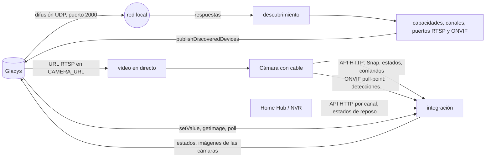
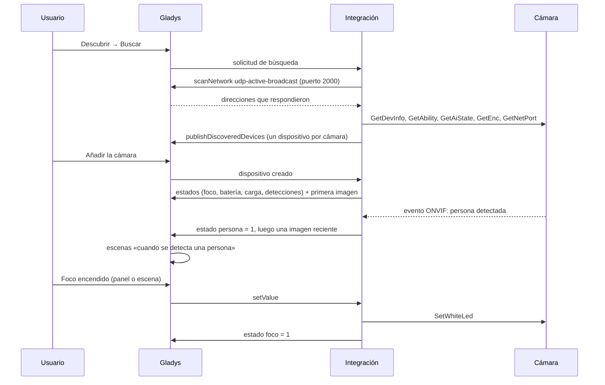
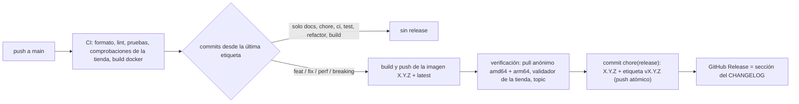

# Gladys Reolink

[English](README.md) · [Français](README.fr.md) · [Deutsch](README.de.md) · **Español**

[](LICENSE)
[](https://github.com/William-De71/gladys-reolink/releases)
[](https://github.com/William-De71/gladys-reolink/actions/workflows/release.yml)
[](https://gladysassistant.com)


Integración externa para [Gladys Assistant](https://gladysassistant.com) que lleva a Gladys las cámaras, timbres de
vídeo, Home Hub y NVR **Reolink**: imágenes en el panel, vídeo en directo, detecciones instantáneas de movimiento,
personas, vehículos, animales y timbre como disparadores de escena, nivel y estado de carga de la batería, y control
del foco, la sirena, los LED infrarrojos y los cabezales motorizados (flechas PTZ y posiciones guardadas). Construida
sobre `@gladysassistant/integration-sdk` 0.15.

Todo se queda **en su red local**: sin cuenta Reolink, sin nube.

Documentación de usuario: [English](docs/en.md) · [Français](docs/fr.md) · [Deutsch](docs/de.md) ·
[Español](docs/es.md).

> Integración comunitaria, ni afiliada a Reolink ni respaldada por Reolink.

## Contenido

- [Funciones](#funciones)
- [Arquitectura](#arquitectura)
- [Dispositivos](#dispositivos)
- [Instalación](#instalación)
- [Configuración](#configuración)
- [Escenas](#escenas)
- [Detecciones instantáneas mediante ONVIF](#detecciones-instantáneas-mediante-onvif)
- [Protección de la batería](#protección-de-la-batería)
- [Transporte](#transporte)
- [Desarrollo](#desarrollo)
- [Release y convención de commits](#release-y-convención-de-commits)
- [Solución de problemas](#solución-de-problemas)
- [Notas de diseño](#notas-de-diseño)
- [Contribuir](#contribuir)
- [Licencia](#licencia)

## Funciones

- **Un dispositivo por cámara**, tanto si se alcanza directamente como si está conectada a un **Home Hub** o a un
  **NVR**. Cada una recibe las funciones que realmente tiene: la integración pregunta a la cámara (`GetAbility`,
  `GetAiState`) en lugar de fiarse del nombre del modelo.
- **Imagen** en el panel, actualizada periódicamente y con cada detección, y **vídeo en directo** a través del
  servicio rtsp-camera de Gladys.
- **Detecciones**: movimiento, persona, vehículo, animal y timbre, enviadas **al instante mediante ONVIF** por las
  cámaras con cable y consultadas periódicamente en las demás.
- **Actuadores**: foco, sirena, LED infrarrojos, flechas PTZ (pasos limitados) y posiciones guardadas.
- **Modelos con batería**: nivel, estado de carga y una protección que espacia las capturas antes de que la batería
  se agote y nunca despierta una cámara que su hub indica como dormida.
- **Acciones de configuración**: probar la conexión (qué sabe hacer cada cámara, ONVIF, RTSP), listar las posiciones
  PTZ, actualizar todas las imágenes.
- **Cuatro idiomas** para la pantalla de configuración y los resultados de las acciones: inglés, francés, alemán,
  español.

La integración no declara ningún widget de panel propio: las cámaras usan el widget de cámara de Gladys.

## Arquitectura




De la búsqueda a una detección:



## Dispositivos

| Lado Reolink              | Función de Gladys (categoría / tipo)               | En qué cámaras                               |
| ------------------------- | -------------------------------------------------- | -------------------------------------------- |
| Instantánea (`cmd=Snap`)  | `camera` / `image`, más el vídeo en directo (RTSP) | todas                                        |
| Movimiento                | `motion-sensor` / `binary` «Motion»                | todas                                        |
| Detecciones IA            | `motion-sensor` / `binary` «Person/Vehicle/Animal» | modelos con detección IA                     |
| Botón del timbre          | `doorbell` / `ring`                                | timbres de vídeo                             |
| Batería                   | `battery` / `integer` (%) y `battery` / `charging` | modelos con batería y solares                |
| Foco                      | `light` / `binary` (releído en la cámara)          | modelos con foco blanco                      |
| Sirena                    | `siren` / `binary`                                 | modelos con altavoz de alarma                |
| LED infrarrojos           | `switch` / `binary` (releído en la cámara)         | la mayoría de los modelos                    |
| Giro / inclinación / zoom | `camera` / `move` (flechas, pasos limitados)       | cámaras motorizadas (o solo con zoom)        |
| Posiciones guardadas      | `camera` / `preset` (lista de posiciones)          | cámaras motorizadas con posiciones guardadas |

Un dispositivo lleva en sus parámetros todo lo necesario para alcanzar su cámara (dirección, puerto, esquema, canal,
capacidades, URL RTSP, puerto ONVIF): un poll, un comando o una imagen nunca necesitan un nuevo descubrimiento. Su
identificador externo se basa en el **UID** de la cámara, luego en su dirección MAC y luego en su dirección IP:
sobrevive a un cambio de nombre y a una nueva concesión DHCP.

## Instalación

Desde Gladys (5.0.0 o posterior): **Integraciones → tienda → Reolink → Instalar**. Introduzca el usuario y la
contraseña de las cámaras, pulse **Probar la conexión**, luego **Descubrir → Buscar** y añada las cámaras. Consulte la
[documentación de usuario](docs/es.md).

En las cámaras, active **HTTP** o **HTTPS** (imprescindible), **RTSP** (vídeo en directo) y **ONVIF** (detecciones
instantáneas) en la aplicación Reolink: Ajustes → Red → Avanzado → Configuración del servidor. Los firmwares recientes
los traen desactivados.

Imagen Docker: `ghcr.io/william-de71/gladys-reolink`, multiarquitectura (amd64/arm64), sin root, sistema de archivos
de solo lectura, etiquetas OCI. Incluye `ffmpeg`, que solo sirve para reducir una instantánea demasiado grande.

## Configuración

| Clave                            | Tipo    | Por defecto | Función                                                                                    |
| -------------------------------- | ------- | ----------- | ------------------------------------------------------------------------------------------ |
| `username`                       | string  | `admin`     | la cuenta con la que Gladys inicia sesión, la de la aplicación Reolink                     |
| `password`                       | secret  | —           | su contraseña                                                                              |
| `stream_quality`                 | select  | `HD`        | HD (flujo principal, reducido si hace falta) o SD (flujo secundario, más ligero)           |
| `camera_addresses`               | string  | —           | direcciones que la búsqueda no alcanza: `192.168.1.42, 192.168.1.43:8000`                  |
| `camera_accounts`                | secret  | —           | cuentas por cámara: `192.168.1.42\|gladys\|MiContraseña`, separadas por comas              |
| `event_poll_interval`            | number  | 15          | segundos (5-300) entre dos consultas de las cámaras que no envían sus eventos              |
| `onvif_events`                   | boolean | activado    | detecciones instantáneas mediante ONVIF para las cámaras con cable alcanzadas directamente |
| `capture_timeout`                | number  | 12          | segundos (5-60) que se da a una cámara para responder                                      |
| `image_refresh_interval`         | number  | 60          | segundos (15-3600) entre dos imágenes de una cámara enchufada                              |
| `battery_image_refresh_interval` | number  | 900         | segundos (60-86400) entre dos imágenes de una cámara con batería                           |
| `battery_pause_refresh`          | number  | 60          | % por debajo del cual se detiene la actualización automática                               |
| `battery_stop_all`               | number  | 40          | % por debajo del cual no se captura ninguna imagen                                         |
| `battery_resume`                 | number  | 80          | % al que una cámara en pausa se reanuda (con solar; con cargador, al instante)             |

## Escenas

La integración no declara disparadores ni acciones de escena propios: todo lo que informa una cámara es una
**función de dispositivo**, que el editor de escenas de Gladys ya ofrece.

- **Disparadores**: «Si suena el timbre» en un timbre; un detector de movimiento llamado «Person», «Vehicle» o
  «Animal» pasa a 1 («cuando se detecta una persona en la verja»); la batería baja de un nivel; una cámara con
  batería empieza o deja de cargarse.
- **Acciones**: encender o apagar el foco, la sirena o los LED infrarrojos; llevar una cámara motorizada a una
  posición guardada (Preset) o moverla un paso (Move); enviar la imagen de la cámara en un mensaje.

Ejemplo: **Si** se detecta «Verja - Person» **entonces** encender «Verja - Spotlight», enviar la imagen de «Verja» a
la familia y apagar el foco al cabo de 3 minutos.

Una detección es un impulso 1 → 0: el sensor vuelve a 0 cuando la cámara informa del fin del evento (o tras un
plazo de seguridad), de modo que la misma escena vuelve a dispararse en la siguiente detección.

## Detecciones instantáneas mediante ONVIF


La API HTTP de Reolink solo responde a «¿hay movimiento ahora mismo?»: una cámara consultada tiene un retraso de
detección igual al intervalo de consulta, y un evento breve entre dos consultas se pierde. Por eso las cámaras con
cable alcanzadas directamente se suscriben mediante **ONVIF** (suscripción pull-point, resumen WS-UsernameToken): la
cámara mantiene la petición abierta y responde en cuanto una detección empieza o termina.

- El puerto ONVIF viene de `GetNetPort`, que también revela cuándo RTSP u ONVIF están desactivados — el ajuste por
  defecto de los firmwares recientes.
- El resumen se fecha con el reloj **de la cámara** (leído mediante `GetSystemDateAndTime`, sin autenticación): una
  cámara cuyo reloj se desvía no es rechazada.
- Mientras el flujo de una cámara está sano, la consulta se detiene para ella; tras tres fallos vuelve a la consulta
  periódica y regresa sola a ONVIF cuando el flujo se recupera.
- Los modelos con batería y los canales de hub o NVR siguen con la consulta periódica: los primeros no tienen
  servidor ONVIF, y los eventos de los segundos no indican de forma fiable de qué cámara proceden.

## Protección de la batería


Capturar es lo que agota una cámara sin cables. La protección retrocede en dos niveles, solo se reanuda bien por
encima del umbral de pausa (los ciclos cortos desgastan la batería), libera al instante una cámara puesta en su
cargador y nunca despierta una cámara que su hub indica como dormida. Las cámaras con batería tienen además su propio
intervalo de actualización: cuidarlas no cuesta nada a las cámaras con cable. El nivel de batería y el estado de carga
se siguen leyendo en todos los casos: son los que indican cuándo la cámara se ha recargado.

## Transporte

Solo `local`. La integración alcanza cada cámara en la red local, mediante su API HTTP documentada, ONVIF y RTSP;
nunca llama a un servidor de Reolink. El descubrimiento pasa por Gladys, que difunde en el puerto UDP 2000 en nombre
de la integración (un contenedor nunca recibe una difusión de la red local). Las cámaras de otra VLAN pueden
introducirse por su dirección.

## Desarrollo

```bash
npm install
npm test               # pruebas unitarias (node --test), sin red ni cámara
npm run lint           # ESLint
npm run format:check   # Prettier, como en la CI
npx github:GladysAssistant/integration-store . --skip-image-check   # comprobaciones de la tienda
docker build -t gladys-reolink:dev .
```

`ffmpeg` es opcional en local: solo reduce una instantánea demasiado grande. Sin él, la integración recurre al flujo
de baja resolución de la cámara. Organización del código: véase [CLAUDE.md](CLAUDE.md).

- `test/structure.test.js` compara los dispositivos construidos para cuatro cámaras de ejemplo (con cable PTZ, timbre
  con batería, canal de Home Hub, cámara básica) y las claves de configuración y de acciones con
  `test/fixtures/discovery.baseline.json`, generado a partir de la versión 1.3.0: un identificador externo, una
  categoría, un tipo o un límite nunca cambian — los usuarios tendrían que borrar y volver a crear sus cámaras.
- `test/index.test.js` ejecuta `index.js` contra el Gladys simulado del SDK (creación de dispositivos, polls,
  comandos).
- `test/i18n.test.js` comprueba los cuatro idiomas del manifiesto, los mensajes, la documentación y los README.
- `test/release.test.js` cubre el script de release (versiones, changelog, actualización de versión).

Requisitos: Gladys `>= 5.0.0` (la función `battery` / `charging`), Node.js `>= 22.20`.

## Release y convención de commits

Los releases son automáticos. Cada push a `main` lanza el workflow Release:



- Los commits y títulos de PR siguen [Conventional Commits](https://www.conventionalcommits.org/), en inglés y
  escritos para el usuario: se convierten en las líneas del changelog. `feat` → menor, `fix` / `perf` → parche, `!` o
  `BREAKING CHANGE:` → mayor.
- `CHANGELOG.md` se genera en el release: nunca lo edite a mano.
- La imagen se publica y se verifica **antes** de que el manifiesto de `main` anuncie la nueva versión.
- Ejecución manual (Actions → Release → Run workflow): `release-as` fuerza una versión, `dry-run` solo muestra la
  versión y las notas.
- Una rama `main` protegida rechazaría el commit de release: permita que GitHub Actions omita la regla, o use el token
  de una GitHub App.

## Solución de problemas

| Síntoma                                               | Causa probable                                                                               |
| ----------------------------------------------------- | -------------------------------------------------------------------------------------------- |
| La búsqueda no encuentra ninguna cámara               | difusión filtrada u otra VLAN: introduzca la dirección en «Direcciones de las cámaras»       |
| «Conexión rechazada» en la prueba                     | contraseña incorrecta, o una cuenta de invitado que no puede leer los ajustes                |
| El vídeo en directo no arranca                        | RTSP está desactivado en la cámara: actívelo en la aplicación Reolink y busque de nuevo      |
| Las detecciones llegan con varios segundos de retraso | la cámara se consulta: ONVIF desactivado, modelo con batería o detrás de un hub (prueba)     |
| La imagen del panel está congelada                    | cámara con batería en pausa (mire su nivel), o intervalo muy largo                           |
| El foco se apaga solo                                 | el horario de iluminación de la cámara; Gladys solo lo amplía mientras lo mantiene encendido |
| Falta una posición en Preset                          | las posiciones se leen al descubrir: busque de nuevo tras guardar una                        |
| No hay «Charging» en una cámara añadida antes         | función nueva: Descubrir → Buscar y luego **Actualizar** la cámara                           |

Registros detallados: defina la variable de entorno `DEBUG=gladys-integration-sdk` en el contenedor.

## Notas de diseño

**Todo se lee en un solo lote.** La API funciona por lotes, y un poll pide movimiento, estado IA, batería y timbre en
un único viaje de ida y vuelta. En un modelo con batería cada petición despierta la radio: lecturas separadas
costarían un despertar cada una.

**Una sesión por dirección de cámara, compartida.** Una cámara solo acepta un puñado de sesiones simultáneas y no las
libera cuando el cliente se va. La captura, los actuadores y el poll comparten por tanto un cliente por dirección.
ONVIF lleva su propia prueba en cada petición y no ocupa ninguna de esas sesiones.

**Una captura a la vez por cámara.** El bucle de actualización, el poll de Gladys, una detección y el panel pueden
pedir la misma cámara en el mismo segundo; comparten la captura en curso en lugar de despertar la cámara varias veces.

**Solo los cambios.** Detecciones, batería y actuadores se publican cuando cambian, nunca se reenvían en cada poll:
Gladys acepta 300 estados por minuto de una integración, y un valor sin cambios solo añadiría ruido al historial.
Cuando el usuario añade una cámara, todo se vuelve a publicar una vez, ya que Gladys descarta los estados enviados
antes de que exista un dispositivo.

**Las capacidades vienen de la cámara, nunca del nombre del modelo.** Dos cámaras de la misma gama difieren, y
`GetAbility` depende del usuario. El cabezal PTZ se lee de `ptzType`, cuya versión enumera la mecánica (solo zoom,
solo giro/inclinación, ambos) en lugar de indicar un simple soporte.

**Los movimientos PTZ están acotados.** `PtzCtrl` inicia un movimiento continuo que solo termina con `Stop`: cada
movimiento es por tanto un paso corto que se detiene solo, y una escena que envía un valor aislado nunca deja una
cámara girando.

**Los ajustes del usuario no se sobrescriben para siempre.** Encender el foco amplía su horario de iluminación a todo
el día; el horario original se lee antes y se restaura cuando Gladys lo apaga.

**La ruta RTSP no es mecánica.** El canal se numera allí desde 1 con dos cifras (`01`) mientras que cada comando JSON
lo numera desde 0, y el códec forma parte de la ruta — una cámara reciente sirve h265 en su flujo principal, por eso
se consulta `GetEnc` en lugar de suponerlo.

**Un Home Hub es una dirección que reúne varias cámaras.** Cada cámara emparejada se convierte en su propio
dispositivo, identificado por su propio UID cuando el hub lo anuncia (un canal es una posición, no una identidad),
compartiendo la sesión del hub pero nunca su descripción. El hub también indica qué cámaras con batería están dormidas
y responde en su nombre.

**Fuera de alcance**: la grabación y reproducción de lo que un hub o un NVR almacenó en su disco. Esta integración lee
el estado en directo y captura imágenes; la cronología grabada es otro proyecto.

## Contribuir

Las issues y pull requests son bienvenidas: informes de errores con la versión de Gladys, la versión de la
integración, el modelo y el firmware de la cámara, y los registros ([plantillas de issue](.github/ISSUE_TEMPLATE)).
También se aceptan comentarios en el
[hilo del foro de Gladys](https://community.gladysassistant.com/t/integration-externe-reolink/10484) (en francés).
Problemas de seguridad: véase [SECURITY.md](SECURITY.md).

## Licencia

[Apache-2.0](LICENSE) — véase [NOTICE](NOTICE). Reolink es una marca de su propietario; este proyecto no está
afiliado a ella.
