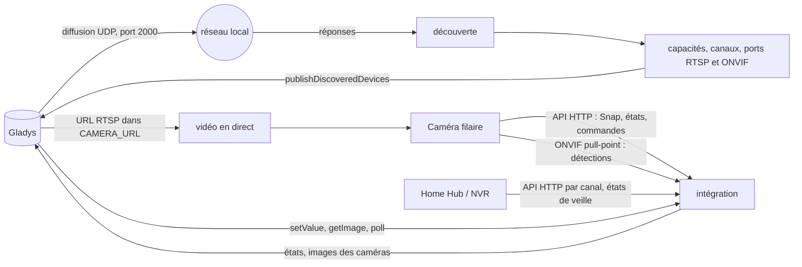
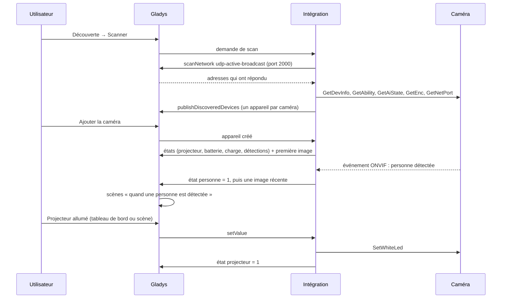
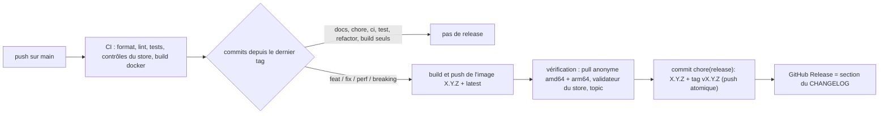

# Gladys Reolink

[English](README.md) · **Français** · [Deutsch](README.de.md) · [Español](README.es.md)

[](LICENSE)
[](https://github.com/William-De71/gladys-reolink/releases)
[](https://github.com/William-De71/gladys-reolink/actions/workflows/release.yml)
[](https://gladysassistant.com)


Intégration externe pour [Gladys Assistant](https://gladysassistant.com) qui amène dans Gladys les caméras, sonnettes
vidéo, Home Hub et NVR **Reolink** : images sur le tableau de bord, vidéo en direct, détections instantanées de
mouvement, de personne, de véhicule, d'animal et de sonnette comme déclencheurs de scène, niveau et état de charge de
la batterie, et pilotage du projecteur, de la sirène, des LED infrarouges et des têtes motorisées (flèches PTZ et
positions enregistrées). Construite sur `@gladysassistant/integration-sdk` 0.15.

Tout reste **sur votre réseau local** : pas de compte Reolink, pas de cloud.

Documentation utilisateur : [English](docs/en.md) · [Français](docs/fr.md) · [Deutsch](docs/de.md) ·
[Español](docs/es.md).

> Intégration communautaire, ni affiliée à Reolink ni approuvée par Reolink.

## Sommaire

- [Fonctionnalités](#fonctionnalités)
- [Architecture](#architecture)
- [Appareils](#appareils)
- [Installation](#installation)
- [Configuration](#configuration)
- [Scènes](#scènes)
- [Détections instantanées via ONVIF](#détections-instantanées-via-onvif)
- [Protection de la batterie](#protection-de-la-batterie)
- [Transport](#transport)
- [Développement](#développement)
- [Release et convention de commits](#release-et-convention-de-commits)
- [Dépannage](#dépannage)
- [Notes de conception](#notes-de-conception)
- [Contribuer](#contribuer)
- [Licence](#licence)

## Fonctionnalités

- **Un appareil par caméra**, qu'elle soit jointe directement ou rattachée à un **Home Hub** ou à un **NVR**.
  Chacune reçoit les fonctionnalités qu'elle possède réellement : l'intégration interroge la caméra (`GetAbility`,
  `GetAiState`) au lieu de se fier au nom du modèle.
- **Image** sur le tableau de bord, rafraîchie à intervalle régulier et à chaque détection, et **vidéo en direct**
  via le service rtsp-camera de Gladys.
- **Détections** : mouvement, personne, véhicule, animal et sonnerie, poussées **instantanément via ONVIF** par les
  caméras filaires, vérifiées régulièrement sur les autres.
- **Actionneurs** : projecteur, sirène, LED infrarouges, flèches PTZ (pas limités) et positions enregistrées.
- **Modèles sur batterie** : niveau, état de charge, et une protection qui espace les captures avant que la
  batterie ne s'épuise et ne réveille jamais une caméra que son hub signale en veille.
- **Actions de configuration** : tester la connexion (ce que sait faire chaque caméra, ONVIF, RTSP), lister les
  positions PTZ, rafraîchir toutes les images.
- **Quatre langues** pour l'écran de configuration et les résultats des actions : anglais, français, allemand,
  espagnol.

L'intégration ne déclare pas de widget de tableau de bord : les caméras utilisent le widget caméra de Gladys.

## Architecture




Du scan à une détection :



## Appareils

| Côté Reolink            | Fonctionnalité Gladys (catégorie / type)             | Sur quelles caméras                            |
| ----------------------- | ---------------------------------------------------- | ---------------------------------------------- |
| Instantané (`cmd=Snap`) | `camera` / `image`, plus la vidéo en direct (RTSP)   | toutes                                         |
| Mouvement               | `motion-sensor` / `binary` « Motion »                | toutes                                         |
| Détections IA           | `motion-sensor` / `binary` « Person/Vehicle/Animal » | modèles avec détection IA                      |
| Bouton de sonnette      | `doorbell` / `ring`                                  | sonnettes vidéo                                |
| Batterie                | `battery` / `integer` (%) et `battery` / `charging`  | modèles sur batterie et solaires               |
| Projecteur              | `light` / `binary` (relu sur la caméra)              | modèles avec projecteur blanc                  |
| Sirène                  | `siren` / `binary`                                   | modèles avec haut-parleur d'alarme             |
| LED infrarouges         | `switch` / `binary` (relu sur la caméra)             | la plupart des modèles                         |
| Pan / tilt / zoom       | `camera` / `move` (flèches, pas limités)             | caméras motorisées (ou à zoom seul)            |
| Positions enregistrées  | `camera` / `preset` (liste des positions)            | caméras motorisées avec positions enregistrées |

Un appareil porte dans ses paramètres tout ce qu'il faut pour joindre sa caméra (adresse, port, schéma, canal,
capacités, URL RTSP, port ONVIF) : un poll, une commande ou une image n'exige jamais de nouvelle découverte. Son
identifiant externe repose sur l'**UID** de la caméra, puis son adresse MAC, puis son adresse IP : il survit à un
renommage et à un changement de bail DHCP.

## Installation

Depuis Gladys (5.0.0 ou plus récent) : **Intégrations → store → Reolink → Installer**. Renseignez l'identifiant et le
mot de passe des caméras, cliquez sur **Tester la connexion**, puis **Découverte → Scanner** et ajoutez les caméras.
Voir la [documentation utilisateur](docs/fr.md).

Sur les caméras, activez **RTSP** (vidéo en direct) et **ONVIF** (détections instantanées) dans l'application
Reolink : Paramètres → Réseau → Avancé → Paramètres du serveur. Les firmwares récents les livrent désactivés.

Image Docker : `ghcr.io/william-de71/gladys-reolink`, multi-architecture (amd64/arm64), utilisateur non root, système
de fichiers en lecture seule, labels OCI. Elle embarque `ffmpeg`, utilisé uniquement pour réduire un instantané trop
lourd.

## Configuration

| Clé                              | Type    | Défaut  | Rôle                                                                                       |
| -------------------------------- | ------- | ------- | ------------------------------------------------------------------------------------------ |
| `username`                       | string  | `admin` | le compte avec lequel Gladys se connecte, celui de l'application Reolink                   |
| `password`                       | secret  | —       | son mot de passe                                                                           |
| `stream_quality`                 | select  | `HD`    | HD (flux principal, réduit si besoin) ou SD (flux secondaire, plus léger sur batterie)     |
| `camera_addresses`               | string  | —       | adresses que le scan ne peut pas joindre : `192.168.1.42, 192.168.1.43:8000`               |
| `camera_accounts`                | secret  | —       | comptes par caméra : `192.168.1.42\|gladys\|MonMotDePasse`, séparés par des virgules       |
| `event_poll_interval`            | number  | 15      | secondes (5-300) entre deux vérifications des caméras qui ne poussent pas leurs événements |
| `onvif_events`                   | boolean | activé  | détections instantanées via ONVIF pour les caméras filaires jointes directement            |
| `capture_timeout`                | number  | 12      | secondes (5-60) laissées à une caméra pour répondre                                        |
| `image_refresh_interval`         | number  | 60      | secondes (15-3600) entre deux images d'une caméra sur secteur                              |
| `battery_image_refresh_interval` | number  | 900     | secondes (60-86400) entre deux images d'une caméra sur batterie                            |
| `battery_pause_refresh`          | number  | 60      | % en dessous duquel le rafraîchissement automatique s'arrête                               |
| `battery_stop_all`               | number  | 40      | % en dessous duquel plus aucune image n'est capturée                                       |
| `battery_resume`                 | number  | 80      | % auquel une caméra en pause reprend (sur solaire ; sur chargeur, elle reprend aussitôt)   |

## Scènes

L'intégration ne déclare ni déclencheur ni action de scène propres : tout ce que signale une caméra est une
**fonctionnalité d'appareil**, que l'éditeur de scènes de Gladys propose déjà.

- **Déclencheurs** : « Si la sonnette sonne » sur une sonnette ; un détecteur de mouvement nommé « Person »,
  « Vehicle » ou « Animal » passe à 1 (« quand une personne est détectée au portail ») ; la batterie descend sous un
  niveau ; une caméra sur batterie commence ou cesse de se recharger.
- **Actions** : allumer ou éteindre le projecteur, la sirène ou les LED infrarouges ; envoyer une caméra motorisée
  sur une position enregistrée (Preset) ou la déplacer d'un pas (Move) ; envoyer l'image de la caméra dans un
  message.

Exemple : **Si** « Portail - Person » est détecté **alors** allumer « Portail - Spotlight », envoyer l'image de
« Portail » à la famille, et éteindre le projecteur au bout de 3 minutes.

Une détection est une impulsion 1 → 0 : le capteur revient à 0 quand la caméra signale la fin de l'événement (ou
après un délai de sécurité), si bien que la même scène se redéclenche à la détection suivante.

## Détections instantanées via ONVIF


L'API HTTP de Reolink répond seulement à « y a-t-il un mouvement en ce moment » : une caméra interrogée a donc un
retard de détection égal à l'intervalle de vérification, et un événement bref entre deux vérifications est perdu. Les
caméras filaires jointes directement sont donc abonnées via **ONVIF** (abonnement pull-point, condensé
WS-UsernameToken) : la caméra garde la requête ouverte et répond dès qu'une détection commence ou se termine.

- Le port ONVIF vient de `GetNetPort`, qui révèle aussi quand RTSP ou ONVIF est désactivé — le réglage par défaut
  des firmwares récents.
- Le condensé est horodaté sur l'horloge **de la caméra** (lue via `GetSystemDateAndTime`, sans authentification) :
  une caméra dont l'horloge dérive n'est pas rejetée.
- Tant que le flux d'une caméra est sain, le poll s'efface pour elle ; après trois échecs, elle repasse en
  vérification régulière, puis revient d'elle-même à ONVIF quand le flux se rétablit.
- Les modèles sur batterie et les canaux de hub ou de NVR restent en vérification régulière : les premiers n'ont pas
  de serveur ONVIF, et les événements des seconds n'indiquent pas de façon fiable de quelle caméra ils viennent.

## Protection de la batterie


C'est la capture qui vide une caméra sans fil. La protection recule en deux paliers, ne reprend que bien au-dessus du
seuil de pause (les cycles courts usent la batterie), libère aussitôt une caméra posée sur son chargeur, et ne réveille
jamais une caméra que son hub signale en veille. Les caméras sur batterie ont aussi leur propre intervalle de
rafraîchissement : les ménager ne coûte rien aux caméras filaires. Le niveau de batterie et l'état de charge restent
lus dans tous les cas : ce sont eux qui indiquent quand la caméra s'est rechargée.

## Transport

`local` uniquement. L'intégration joint chaque caméra sur le réseau local, via son API HTTP documentée, ONVIF et RTSP ;
elle n'appelle jamais de serveur Reolink. La découverte passe par Gladys, qui diffuse sur le port UDP 2000 pour le
compte de l'intégration (un conteneur ne reçoit jamais une diffusion du réseau local). Les caméras d'un autre VLAN
peuvent être saisies par leur adresse.

## Développement

```bash
npm install
npm test               # tests unitaires (node --test), sans réseau ni caméra
npm run lint           # ESLint
npm run format:check   # Prettier, comme dans la CI
npx github:GladysAssistant/integration-store . --skip-image-check   # contrôles du store
docker build -t gladys-reolink:dev .
```

`ffmpeg` est facultatif en local : il ne sert qu'à réduire un instantané trop lourd. Sans lui, l'intégration se rabat
sur le flux basse résolution de la caméra. Organisation du code : voir [CLAUDE.md](CLAUDE.md).

- `test/structure.test.js` compare les appareils construits pour quatre caméras types (filaire PTZ, sonnette sur
  batterie, canal de Home Hub, caméra nue) ainsi que les clés de configuration et d'actions à
  `test/fixtures/discovery.baseline.json`, généré à partir de la version 1.3.0 : un identifiant externe, une
  catégorie, un type ou une borne ne change jamais — les utilisateurs devraient supprimer et recréer leurs caméras.
- `test/index.test.js` exécute `index.js` contre le faux Gladys du SDK (création d'appareil, polls, commandes).
- `test/i18n.test.js` vérifie les quatre langues du manifeste, des messages, des docs et des README.
- `test/release.test.js` couvre le script de release (versions, changelog, mise à jour des versions).

Prérequis : Gladys `>= 5.0.0` (la fonctionnalité `battery` / `charging`), Node.js `>= 22.20`.

## Release et convention de commits

Les releases sont automatiques. Chaque push sur `main` lance le workflow Release :



- Les commits et titres de PR suivent [Conventional Commits](https://www.conventionalcommits.org/), en anglais,
  rédigés pour l'utilisateur : ils deviennent les lignes du changelog. `feat` → mineure, `fix` / `perf` → correctif,
  `!` ou `BREAKING CHANGE:` → majeure.
- `CHANGELOG.md` est généré à la release : ne jamais l'éditer à la main.
- L'image est publiée et vérifiée **avant** que le manifeste de `main` n'annonce la nouvelle version.
- Lancement manuel (Actions → Release → Run workflow) : `release-as` force une version, `dry-run` affiche seulement
  la version et les notes.
- Une branche `main` protégée refuserait le commit de release : autorisez GitHub Actions à contourner la règle, ou
  utilisez le jeton d'une GitHub App.

## Dépannage

| Symptôme                                                  | Cause probable                                                                             |
| --------------------------------------------------------- | ------------------------------------------------------------------------------------------ |
| Aucune caméra trouvée par le scan                         | diffusion filtrée ou autre VLAN : saisissez l'adresse dans « Adresses des caméras »        |
| « Connexion refusée » au test                             | mauvais mot de passe, ou compte invité qui ne peut pas lire les paramètres de la caméra    |
| La vidéo en direct ne démarre pas                         | RTSP est désactivé sur la caméra : activez-le dans l'application Reolink, puis rescannez   |
| Les détections arrivent avec plusieurs secondes de retard | la caméra est interrogée : ONVIF désactivé, modèle sur batterie ou derrière un hub (test)  |
| L'image du tableau de bord est figée                      | caméra sur batterie mise en pause (regardez son niveau), ou intervalle très long           |
| Le projecteur s'éteint tout seul                          | le programme d'éclairage de la caméra ; Gladys ne l'élargit que tant qu'il le garde allumé |
| Une position manque dans Preset                           | les positions sont lues à la découverte : rescannez après en avoir enregistré une          |
| Pas de « Charging » sur une caméra ajoutée avant          | nouvelle fonctionnalité : Découverte → Scanner, puis **Mettre à jour** la caméra           |

Logs détaillés : définissez la variable d'environnement `DEBUG=gladys-integration-sdk` sur le conteneur.

## Notes de conception

**Tout est lu en un seul lot.** L'API fonctionne par lots, et un poll demande mouvement, état IA, batterie et
sonnette en un seul aller-retour. Sur un modèle sur batterie, chaque requête réveille la radio : des lectures
séparées coûteraient un réveil chacune.

**Une session par adresse de caméra, partagée.** Une caméra n'accepte qu'une poignée de sessions simultanées et ne les
libère pas quand le client s'en va. La capture, les actionneurs et le poll partagent donc un client par adresse.
ONVIF porte sa propre preuve à chaque requête et ne consomme aucune de ces sessions.

**Une capture à la fois par caméra.** La boucle de rafraîchissement, le poll de Gladys, une détection et le tableau
de bord peuvent demander la même caméra à une seconde d'intervalle ; ils partagent la capture en cours au lieu de
réveiller la caméra plusieurs fois.

**Les changements seulement.** Détections, batterie et actionneurs sont publiés quand ils changent, jamais renvoyés à
chaque poll : Gladys accepte 300 états par minute d'une intégration, et une valeur inchangée n'ajouterait que du
bruit à l'historique. Quand l'utilisateur ajoute une caméra, tout est republié une fois, puisque Gladys jette les
états envoyés avant qu'un appareil existe.

**Les capacités viennent de la caméra, jamais du nom du modèle.** Deux caméras d'une même gamme diffèrent, et
`GetAbility` dépend de l'utilisateur. La tête PTZ est lue dans `ptzType`, dont la version énumère la mécanique (zoom
seul, pan/tilt seul, les deux) au lieu d'indiquer un simple support.

**Les mouvements PTZ sont bornés.** `PtzCtrl` démarre un mouvement continu qui ne s'arrête que sur `Stop` : chaque
mouvement est donc un pas court qui s'arrête de lui-même, et une scène qui envoie une valeur isolée ne laisse jamais
une caméra tourner.

**Les réglages de l'utilisateur ne sont pas écrasés pour de bon.** Allumer le projecteur élargit son programme
d'éclairage à toute la journée ; le programme d'origine est lu d'abord, puis remis quand Gladys l'éteint.

**Le chemin RTSP n'est pas mécanique.** Le canal y est numéroté à partir de 1 sur deux chiffres (`01`) alors que
chaque commande JSON le numérote à partir de 0, et le codec fait partie du chemin — une caméra récente sert du h265
sur son flux principal, d'où la lecture de `GetEnc` plutôt qu'une supposition.

**Un Home Hub, c'est une adresse qui porte plusieurs caméras.** Chaque caméra appairée devient son propre appareil,
identifiée par son propre UID quand le hub l'annonce (un canal est une position, pas une identité), partageant la
session du hub mais jamais sa description. Le hub indique aussi quelles caméras sur batterie sont en veille, et
répond à leur place.

**Hors périmètre** : l'enregistrement et la relecture de ce qu'un hub ou un NVR a stocké sur son disque. Cette
intégration lit l'état en direct et capture des images ; la chronologie enregistrée est un autre chantier.

## Contribuer

Les issues et pull requests sont les bienvenues : rapports de bug avec la version de Gladys, la version de
l'intégration, le modèle et le firmware de la caméra, et les logs ([modèles d'issue](.github/ISSUE_TEMPLATE)). Les
retours sont aussi bienvenus sur le
[fil du forum Gladys](https://community.gladysassistant.com/t/integration-externe-reolink/10484). Problèmes de
sécurité : voir [SECURITY.md](SECURITY.md).

## Licence

[Apache-2.0](LICENSE) — voir [NOTICE](NOTICE). Reolink est une marque de son propriétaire ; ce projet n'y est pas
affilié.
