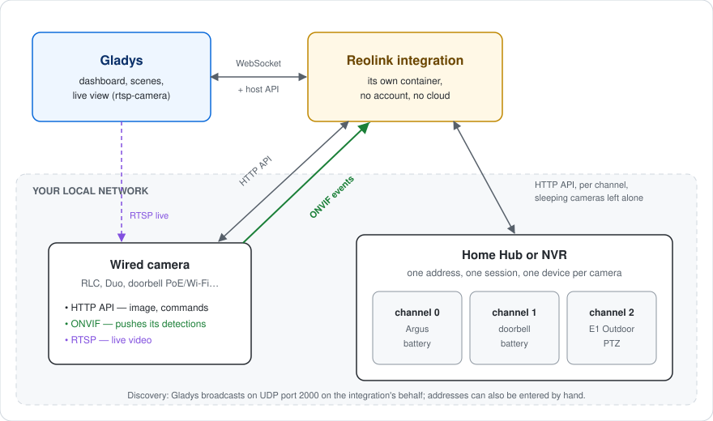
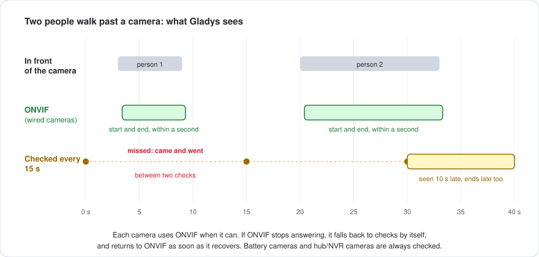
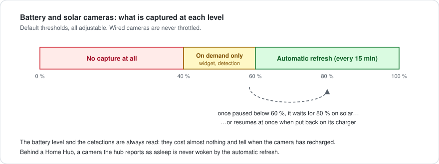

# gladys-reolink


External integration bringing **Reolink** cameras to [Gladys Assistant](https://gladysassistant.com): dashboard snapshots, live video, instant motion / person / vehicle / animal / doorbell detections as scene triggers, battery level, and control of the spotlight, siren, infrared LEDs and motorized heads (PTZ arrows and saved positions).

Everything stays **on your local network**: no Reolink account, no cloud.

📖 User documentation: [English](docs/en.md) — [Français](docs/fr.md) — [Deutsch](docs/de.md) — [Español](docs/es.md)

## How it works



| Reolink side                    | Gladys support                                                                         |
| ------------------------------- | -------------------------------------------------------------------------------------- |
| Standalone camera               | One device, features decided by asking the camera (`GetAbility`, `GetAiState`)         |
| Home Hub / NVR                  | One device per paired camera, all sharing a single session on the hub                  |
| Snapshot (`cmd=Snap`)           | Dashboard image, refreshed on a schedule and on every detection                        |
| RTSP stream                     | Live view through Gladys' rtsp-camera service, on the port the camera reports          |
| Motion, AI detections           | `motion-sensor` features named Motion / Person / Vehicle / Animal                      |
| Doorbell button                 | `doorbell/ring` feature: "Ringing" on the dashboard, "If the doorbell rings" in scenes |
| Spotlight, siren, infrared LEDs | Switches; spotlight and IR read back from the camera                                   |
| Pan / tilt / zoom               | `camera/move` arrows (bounded steps) and `camera/preset` list of saved positions       |
| Battery                         | Level, plus a guard that throttles captures before the cell runs low                   |

Discovery goes through Gladys, which broadcasts on UDP port 2000 on the integration's behalf (a container never receives LAN broadcast). Addresses can also be entered by hand for cameras on another VLAN.

## Instant detections over ONVIF



Reolink's HTTP API only answers "is motion firing right now", so a polled camera has a detection delay equal to the check interval, and a short event between two checks is lost. Wired cameras reached directly are therefore subscribed over **ONVIF** (pull-point subscription, WS-UsernameToken digest): the camera holds the request open and answers the moment a detection starts or ends.

- The ONVIF port comes from `GetNetPort`, which also reveals when RTSP or ONVIF is disabled — the default on recent firmwares.
- The digest is stamped on the **camera's** clock (read through the unauthenticated `GetSystemDateAndTime`), so a camera whose clock drifted is not rejected.
- While a camera's stream is healthy, the poll stands down for it; after three failures it falls back to polling, and goes back to ONVIF on its own once the stream recovers.
- Battery models and hub/NVR channels keep the polled path: the former have no ONVIF server, and the latter's events do not say reliably which camera they come from.

## Battery protection



Capturing is what drains a wire-free camera. The guard backs off in two steps, resumes only well above the pause threshold (shallow cycles wear the cell), releases a camera on its charger at once, and never wakes a camera its hub reports as asleep. Battery cameras also get a refresh interval of their own, so sparing them costs nothing to the wired ones.

## Architecture

```
index.js                    SDK wiring: handlers, actions, lifecycle
src/
  config.js                 defaults, normalization, free-text parsing
  devices.js                cameras -> Gladys devices and features
  messages.js               user-facing messages, in en / fr / de / es
  reolink/
    constants.js            protocol values, capabilities, device params
    api.js                  HTTP client: port probe, token, batching, Snap
    sessions.js             one shared session per camera address
    capabilities.js         GetAbility / GetAiState -> what a camera can do
    channels.js             Home Hub / NVR channels, models, sleep states
    discovery.js            UDP broadcast discovery
    rtsp.js                 live URL (codec, port) and GetNetPort
    snapshot.js             image capture, size-bounded
    commands.js             spotlight, siren, IR, PTZ steps and presets
    onvif.js                ONVIF pull-point events, clock sync, fallback
    events.js               detections (ONVIF or polled) and battery
    batteryGuard.js         capture throttling on battery models
```

## Development

```bash
npm install
npm test          # node --test
npm run lint      # eslint
npm run format    # prettier
```

`ffmpeg` is optional: it only shrinks an oversized snapshot. Without it, the integration falls back to the camera's own low-resolution stream. The Docker image installs it.

Releases are cut from GitHub: **Actions → Release → Run workflow**, then pick the bump. The workflow updates the version in `package.json` and the manifest, regenerates `CHANGELOG.md` from the Conventional Commits, pushes the commit and the tag in one atomic push, publishes the GitHub release and builds the multi-arch image.

## Design notes

**Everything is read in one batch.** The API is batch-oriented, and a poll asks for motion, AI state, battery and doorbell in a single round trip. On a battery model each request wakes the radio, so separate reads would cost one wakeup each.

**One session per camera address, shared.** A camera only accepts a handful of concurrent sessions and does not free them when the client walks away. The capture, the actuators and the poll therefore share one client per address. ONVIF carries its own proof on every request and takes none of those sessions.

**One capture at a time per camera.** The refresh loop, the Gladys poll, a detection and the dashboard can all ask for the same camera within a second; they share the capture in flight instead of waking the camera several times.

**Capabilities come from the camera, never from its model name.** Two cameras of the same range differ, and `GetAbility` is user-scoped. The PTZ head is read from `ptzType`, whose version enumerates the mechanics (zoom only, pan/tilt only, both) rather than flagging support.

**PTZ moves are bounded.** `PtzCtrl` starts a continuous movement that only ends on `Stop`, so every movement is a short step that stops itself: a scene sending a lone value never leaves a camera turning.

**The user's settings are not overwritten for good.** Turning the spotlight on widens its lighting schedule to the whole day; the original schedule is read first and put back when Gladys turns it off.

**The RTSP path is not mechanical.** The channel is 1-based and zero-padded there (`01`) while every JSON command numbers it from 0, and the codec is part of the path — a recent camera serves h265 on its main stream, so `GetEnc` is asked rather than assumed.

**A Home Hub is one address holding several cameras.** Each paired camera becomes its own device, identified by its own UID when the hub announces one (a channel is a position, not an identity), sharing the hub's session but never its description. The hub also reports which battery cameras are asleep, and answers on their behalf.

## Not covered

Recording and playback of what a hub or an NVR stored on its disk. This integration reads live state and captures images; the stored timeline is a separate piece of work.

## License

[Apache-2.0](LICENSE)
