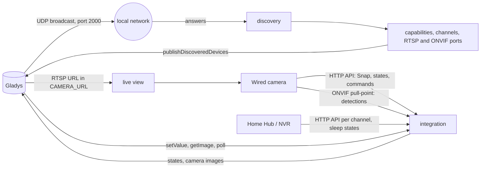
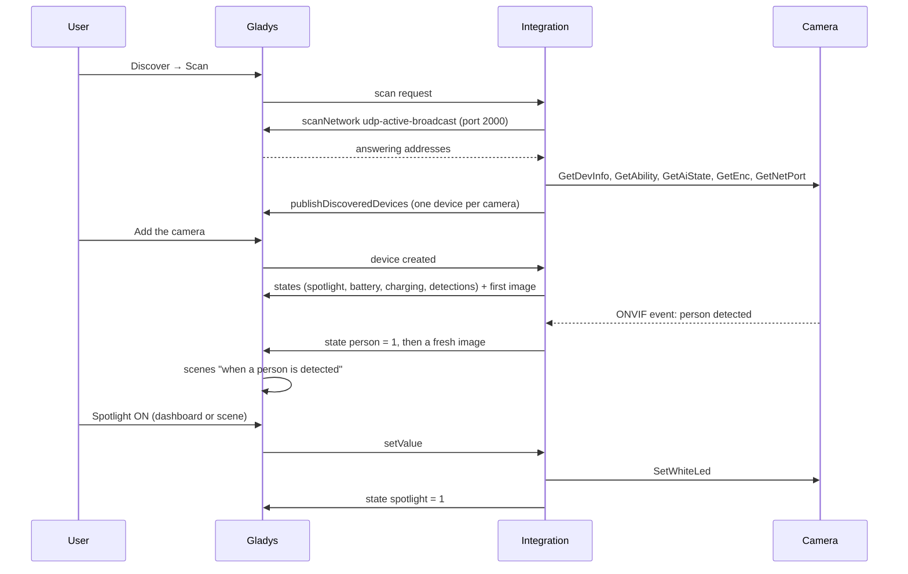
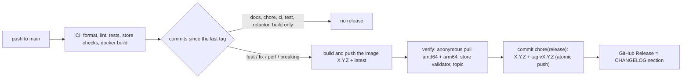

# Gladys Reolink

**English** · [Français](README.fr.md) · [Deutsch](README.de.md) · [Español](README.es.md)

[](LICENSE)
[](https://github.com/William-De71/gladys-reolink/releases)
[](https://github.com/William-De71/gladys-reolink/actions/workflows/release.yml)
[](https://gladysassistant.com)


External [Gladys Assistant](https://gladysassistant.com) integration bringing **Reolink** cameras, video doorbells,
Home Hubs and NVRs into Gladys: dashboard snapshots, live video, instant motion / person / vehicle / animal /
doorbell detections as scene triggers, battery level and charging state, and control of the spotlight, the siren,
the infrared LEDs and the motorized heads (PTZ arrows and saved positions). Built on
`@gladysassistant/integration-sdk` 0.15.

Everything stays **on your local network**: no Reolink account, no cloud.

User documentation: [English](docs/en.md) · [Français](docs/fr.md) · [Deutsch](docs/de.md) · [Español](docs/es.md).

> Community integration, not affiliated with or endorsed by Reolink.

## Contents

- [Features](#features)
- [Architecture](#architecture)
- [Devices](#devices)
- [Installation](#installation)
- [Configuration](#configuration)
- [Scenes](#scenes)
- [Instant detections over ONVIF](#instant-detections-over-onvif)
- [Battery protection](#battery-protection)
- [Transport](#transport)
- [Development](#development)
- [Release and commit convention](#release-and-commit-convention)
- [Troubleshooting](#troubleshooting)
- [Design notes](#design-notes)
- [Contributing](#contributing)
- [License](#license)

## Features

- **One device per camera**, whether it is reached directly or sits behind a **Home Hub** or an **NVR**. Each one
  gets the features it actually has: the integration asks the camera (`GetAbility`, `GetAiState`) rather than
  trusting its model name.
- **Image** on the dashboard, refreshed on a schedule and on every detection, and **live video** through the
  rtsp-camera service of Gladys.
- **Detections**: motion, person, vehicle, animal and doorbell ring, pushed **instantly over ONVIF** by wired
  cameras, checked regularly on the others.
- **Actuators**: spotlight, siren, infrared LEDs, PTZ arrows (bounded steps) and saved positions.
- **Battery models**: level, charging state, and a guard that throttles captures before the cell runs low and never
  wakes a camera its hub reports as asleep.
- **Configuration actions**: test the connection (what each camera can do, ONVIF, RTSP), list the PTZ presets,
  refresh every image.
- **Four languages** for the configuration screen and the action results: English, French, German, Spanish.

The integration declares no dashboard widget of its own: cameras use the camera widget of Gladys.

## Architecture




From the scan to a detection:



## Devices

| Reolink side          | Gladys feature (category / type)                     | On which cameras                       |
| --------------------- | ---------------------------------------------------- | -------------------------------------- |
| Snapshot (`cmd=Snap`) | `camera` / `image`, plus the live view (RTSP)        | all                                    |
| Motion                | `motion-sensor` / `binary` "Motion"                  | all                                    |
| AI detections         | `motion-sensor` / `binary` "Person/Vehicle/Animal"   | models with AI detection               |
| Doorbell button       | `doorbell` / `ring`                                  | video doorbells                        |
| Battery               | `battery` / `integer` (%) and `battery` / `charging` | battery and solar models               |
| Spotlight             | `light` / `binary` (read back from the camera)       | models with a white spotlight          |
| Siren                 | `siren` / `binary`                                   | models with an alarm speaker           |
| Infrared LEDs         | `switch` / `binary` (read back from the camera)      | most models                            |
| Pan / tilt / zoom     | `camera` / `move` (arrows, bounded steps)            | motorized cameras (or zoom lens only)  |
| Saved positions       | `camera` / `preset` (list of the saved positions)    | motorized cameras with positions saved |

A device carries everything needed to reach its camera in its params (address, port, scheme, channel, capabilities,
RTSP URL, ONVIF port), so a poll, a command or an image never needs a new discovery. Its external id is built on the
camera **UID**, then its MAC, then its address: it survives a rename and a DHCP lease change.

## Installation

From Gladys (5.0.0 or later): **Integrations → store → Reolink → Install**. Fill in the username and password of the
cameras, click **Test the connection**, then **Discover → Scan** and add the cameras. See the
[user documentation](docs/en.md).

On the cameras, enable **RTSP** (live video) and **ONVIF** (instant detections) in the Reolink app: Settings →
Network → Advanced → Server settings. Recent firmwares ship with both turned off.

Docker image: `ghcr.io/william-de71/gladys-reolink`, multi-arch (amd64/arm64), non-root, read-only rootfs, OCI
labels. It ships `ffmpeg`, used only to shrink an oversized snapshot.

## Configuration

| Key                              | Type    | Default | Role                                                                            |
| -------------------------------- | ------- | ------- | ------------------------------------------------------------------------------- |
| `username`                       | string  | `admin` | the account Gladys logs in with, the one of the Reolink app                     |
| `password`                       | secret  | —       | its password                                                                    |
| `stream_quality`                 | select  | `HD`    | HD (main stream, shrunk if needed) or SD (sub stream, lighter on a battery)     |
| `camera_addresses`               | string  | —       | addresses the scan cannot reach: `192.168.1.42, 192.168.1.43:8000`              |
| `camera_accounts`                | secret  | —       | per-camera credentials: `192.168.1.42\|gladys\|MyPassword`, comma-separated     |
| `event_poll_interval`            | number  | 15      | seconds (5-300) between two checks of the cameras that do not push their events |
| `onvif_events`                   | boolean | on      | instant detections over ONVIF for the wired cameras reached directly            |
| `capture_timeout`                | number  | 12      | seconds (5-60) a camera is given to answer                                      |
| `image_refresh_interval`         | number  | 60      | seconds (15-3600) between two images of a mains-powered camera                  |
| `battery_image_refresh_interval` | number  | 900     | seconds (60-86400) between two images of a battery camera                       |
| `battery_pause_refresh`          | number  | 60      | % below which the automatic refresh stops                                       |
| `battery_stop_all`               | number  | 40      | % below which no image is captured at all                                       |
| `battery_resume`                 | number  | 80      | % at which a paused camera resumes (on solar; a charger resumes it at once)     |

## Scenes

The integration declares no scene trigger or action of its own: everything a camera reports is a **device
feature**, which the scene editor of Gladys already offers.

- **Triggers**: "If the doorbell rings" on a doorbell; a motion sensor named "Person", "Vehicle" or "Animal" goes to
  1 ("when a person is detected at the gate"); the battery falls below a level; a battery camera starts or stops
  charging.
- **Actions**: turn the spotlight, the siren or the infrared LEDs on or off; move a motorized camera to a saved
  position (Preset) or by one step (Move); send the image of the camera in a message.

Example: **If** "Gate - Person" is detected **then** turn on "Gate - Spotlight", send the image of "Gate" to the
family, and after 3 minutes turn the spotlight off.

A detection is a 1 → 0 pulse: the sensor goes back to 0 when the camera reports the end of the event (or after a
safety delay), so the same scene fires again on the next detection.

## Instant detections over ONVIF


Reolink's HTTP API only answers "is motion firing right now", so a polled camera has a detection delay equal to the
check interval, and a short event between two checks is lost. Wired cameras reached directly are therefore
subscribed over **ONVIF** (pull-point subscription, WS-UsernameToken digest): the camera holds the request open and
answers the moment a detection starts or ends.

- The ONVIF port comes from `GetNetPort`, which also reveals when RTSP or ONVIF is disabled — the default on recent
  firmwares.
- The digest is stamped on the **camera's** clock (read through the unauthenticated `GetSystemDateAndTime`), so a
  camera whose clock drifted is not rejected.
- While a camera's stream is healthy, the poll stands down for it; after three failures it falls back to polling,
  and goes back to ONVIF on its own once the stream recovers.
- Battery models and hub/NVR channels keep the polled path: the former have no ONVIF server, and the latter's events
  do not say reliably which camera they come from.

## Battery protection


Capturing is what drains a wire-free camera. The guard backs off in two steps, resumes only well above the pause
threshold (shallow cycles wear the cell), releases a camera on its charger at once, and never wakes a camera its hub
reports as asleep. Battery cameras also get a refresh interval of their own, so sparing them costs nothing to the
wired ones. The battery level and the charging state keep being read in every case: they are what tells when the
camera has recharged.

## Transport

`local` only. The integration reaches every camera on the local network, over its documented HTTP API, ONVIF and
RTSP; it never calls a Reolink server. Discovery goes through Gladys, which broadcasts on UDP port 2000 on the
integration's behalf (a container never receives a LAN broadcast). Cameras on another VLAN can be entered by
address.

## Development

```bash
npm install
npm test               # unit tests (node --test), no network, no camera
npm run lint           # ESLint
npm run format:check   # Prettier, as the CI runs it
npx github:GladysAssistant/integration-store . --skip-image-check   # store checks
docker build -t gladys-reolink:dev .
```

`ffmpeg` is optional locally: it only shrinks an oversized snapshot. Without it, the integration falls back to the
camera's own low-resolution stream. Layout: see [CLAUDE.md](CLAUDE.md).

- `test/structure.test.js` compares the devices built for four sample cameras (wired PTZ, battery doorbell, Home Hub
  channel, bare camera) and the configuration and action keys to `test/fixtures/discovery.baseline.json`,
  generated from version 1.3.0: an external id, a category, a type or a bound never changes — users would have to
  delete and recreate their cameras.
- `test/index.test.js` runs `index.js` against the fake Gladys of the SDK (device creation, polls, commands).
- `test/i18n.test.js` checks the four languages of the manifest, the messages, the docs and the READMEs.
- `test/release.test.js` covers the release script (versions, changelog, bump).

Requirements: Gladys `>= 5.0.0` (the `battery` / `charging` feature), Node.js `>= 22.20`.

## Release and commit convention

Releases are automatic. Every push to `main` runs the Release workflow:



- Commits and PR titles follow [Conventional Commits](https://www.conventionalcommits.org/), in English, written
  for the user: they become the changelog lines. `feat` → minor, `fix` / `perf` → patch, `!` or
  `BREAKING CHANGE:` → major.
- `CHANGELOG.md` is generated at the release: never edit it by hand.
- The image is published and checked **before** the manifest on `main` announces the new version.
- Manual run (Actions → Release → Run workflow): `release-as` forces a version, `dry-run` only shows the version
  and the notes.
- A protected `main` would reject the release commit: allow GitHub Actions to bypass the rule, or use a GitHub
  App token.

## Troubleshooting

| Symptom                                         | Likely cause                                                                       |
| ----------------------------------------------- | ---------------------------------------------------------------------------------- |
| No camera found by the scan                     | broadcast filtered or another VLAN: enter the address under Camera addresses       |
| "Connection refused" in the test                | wrong password, or a guest account that cannot read the camera settings            |
| Live video does not start                       | RTSP is off on the camera: enable it in the Reolink app, then scan again           |
| Detections arrive several seconds late          | the camera is polled: ONVIF off, battery model or behind a hub (see the test)      |
| The dashboard image is frozen                   | battery camera paused by the guard (look at its level), or a long refresh interval |
| The spotlight switches itself off               | the lighting schedule of the camera; Gladys widens it only while it keeps it on    |
| A saved position is missing from Preset         | positions are read at discovery: scan again after saving one                       |
| No "Charging" on a battery camera added earlier | new feature: Discover → Scan, then **Update** the camera                           |

Detailed logs: set the environment variable `DEBUG=gladys-integration-sdk` on the container.

## Design notes

**Everything is read in one batch.** The API is batch-oriented, and a poll asks for motion, AI state, battery and
doorbell in a single round trip. On a battery model each request wakes the radio, so separate reads would cost one
wakeup each.

**One session per camera address, shared.** A camera only accepts a handful of concurrent sessions and does not free
them when the client walks away. The capture, the actuators and the poll therefore share one client per address.
ONVIF carries its own proof on every request and takes none of those sessions.

**One capture at a time per camera.** The refresh loop, the Gladys poll, a detection and the dashboard can all ask
for the same camera within a second; they share the capture in flight instead of waking the camera several times.

**Changes only.** Detections, battery and actuators are published when they change, never re-sent on every poll:
Gladys accepts 300 states per minute from an integration, and an unchanged value would only add history noise. When
the user adds a camera, everything is published once more, since Gladys drops the states sent before a device
exists.

**Capabilities come from the camera, never from its model name.** Two cameras of the same range differ, and
`GetAbility` is user-scoped. The PTZ head is read from `ptzType`, whose version enumerates the mechanics (zoom only,
pan/tilt only, both) rather than flagging support.

**PTZ moves are bounded.** `PtzCtrl` starts a continuous movement that only ends on `Stop`, so every movement is a
short step that stops itself: a scene sending a lone value never leaves a camera turning.

**The user's settings are not overwritten for good.** Turning the spotlight on widens its lighting schedule to the
whole day; the original schedule is read first and put back when Gladys turns it off.

**The RTSP path is not mechanical.** The channel is 1-based and zero-padded there (`01`) while every JSON command
numbers it from 0, and the codec is part of the path — a recent camera serves h265 on its main stream, so `GetEnc`
is asked rather than assumed.

**A Home Hub is one address holding several cameras.** Each paired camera becomes its own device, identified by its
own UID when the hub announces one (a channel is a position, not an identity), sharing the hub's session but never
its description. The hub also reports which battery cameras are asleep, and answers on their behalf.

**Not covered**: recording and playback of what a hub or an NVR stored on its disk. This integration reads live
state and captures images; the stored timeline is a separate piece of work.

## Contributing

Issues and pull requests are welcome: bug reports with the Gladys version, the integration version, the camera model
and firmware, and the logs ([issue templates](.github/ISSUE_TEMPLATE)). Feedback on the
[Gladys forum thread](https://community.gladysassistant.com/t/integration-externe-reolink/10484) too. Security
problems: see [SECURITY.md](SECURITY.md).

## License

[Apache-2.0](LICENSE) — see [NOTICE](NOTICE). Reolink is a trademark of its owner; this project is not affiliated
with it.
